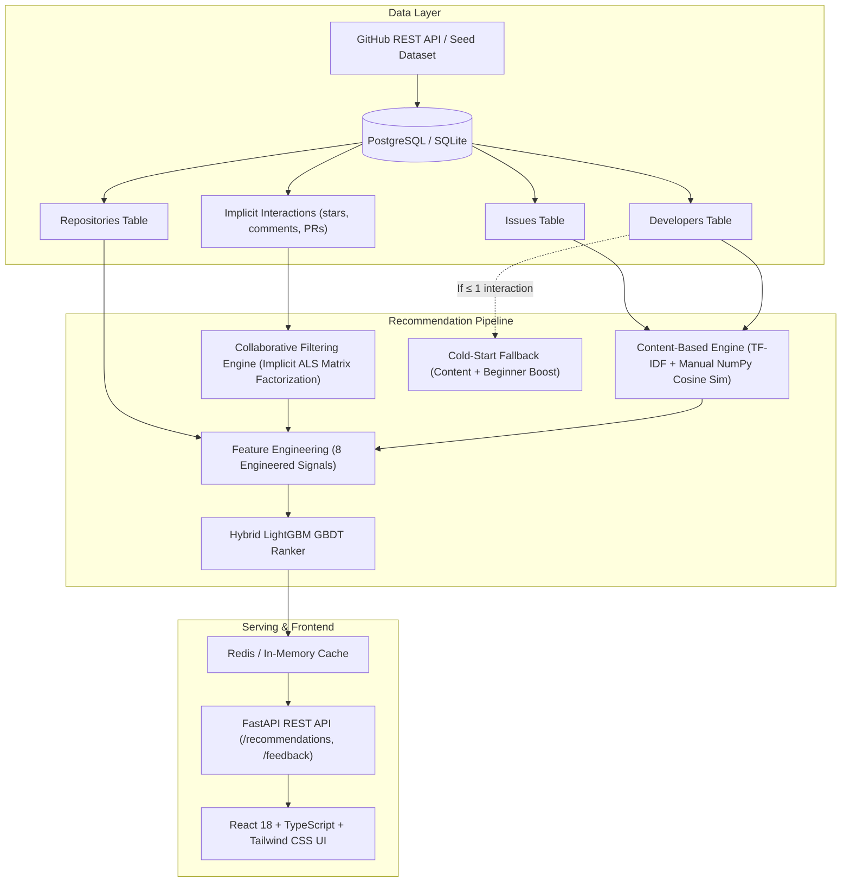

# GitMatch — Open-Source Issue Recommender System

[](https://fastapi.tiangolo.com)
[](https://react.dev)
[](https://www.typescriptlang.org)
[](https://lightgbm.readthedocs.io)
[](https://www.postgresql.org)
[](https://www.docker.com)

An intelligent full-stack recommendation engine that matches open-source contributors with the most relevant GitHub issues based on their technical skills, commit history, and latent community collaboration patterns.

---

## 📌 Problem Statement

Over 80% of open-source newcomers struggle to identify suitable issues due to:
1. **Information Overload**: Thousands of repositories with tens of thousands of uncurated open issues.
2. **Skill Mismatch**: Generic search queries do not account for a contributor's specific programming language proficiency, framework familiarity, or past contribution patterns.
3. **Cold-Start Barriers**: New developers have zero prior interactions, causing traditional collaborative filtering algorithms to fail completely.

**GitMatch solves this** by fusing semantic text similarity, implicit feedback matrix factorization, and gradient-boosted decision tree ranking into an explainable hybrid recommendation engine with sub-50ms inference latency.

---

## 🏗️ System Architecture



---

## 🧠 Model Choices, Tradeoffs & Mathematical Formulation

### 1. Content-Based Recommender (TF-IDF + Hand-Written NumPy Cosine Similarity)
* **Representation**: Text representation constructed from issue title, body, labels, repo language, and repository topics. Developer representation derived from bio, primary languages, and repository contribution summaries.
* **Pure NumPy Manual Cosine Similarity**:
  $$\text{CosineSimilarity}(\mathbf{u}, \mathbf{v}) = \frac{\mathbf{u} \cdot \mathbf{v}}{\|\mathbf{u}\|_2 \times \|\mathbf{v}\|_2} = \frac{\sum_{i=1}^n u_i v_i}{\sqrt{\sum_{i=1}^n u_i^2} \sqrt{\sum_{i=1}^n v_i^2}}$$
* **Tradeoff**: Handles new repositories and cold-start developers well by matching text semantics, but cannot capture popularity bias, community engagement, or non-textual quality signals.
  
### 2. Collaborative Filtering (Implicit Alternating Least Squares — ALS)
* **Why ALS over SGD for Implicit Feedback?**
  In open-source activity, developers only leave positive signals (stars, comments, PR merges) with varying confidence ($r_{ui}$). There are no explicit negative 1-star ratings; unobserved issues may either be disliked or simply undiscovered.
* **Hu, Koren & Volinsky Formulation**:
  * Preference: $p_{ui} = 1 \text{ if } r_{ui} > 0 \text{ else } 0$
  * Confidence: $c_{ui} = 1 + \alpha r_{ui} \quad (\alpha = 40.0)$
  * Closed-form alternating updates:
    $$\mathbf{x}_u = \left(\mathbf{Y}^T \mathbf{C}_u \mathbf{Y} + \lambda \mathbf{I}\right)^{-1} \mathbf{Y}^T \mathbf{C}_u \mathbf{p}_u$$
    $$\mathbf{y}_i = \left(\mathbf{X}^T \mathbf{C}_i \mathbf{X} + \lambda \mathbf{I}\right)^{-1} \mathbf{X}^T \mathbf{C}_i \mathbf{p}_i$$
* **Tradeoff**: Discovers unexpected cross-domain issues based on community contribution affinity, but suffers completely from the cold-start problem when a developer has no interaction history.

### 3. Hybrid LightGBM Ranker
* **Why a Ranker instead of averaging scores?**
  Content similarity and CF latent scores live on fundamentally different probability distributions and scales. A simple weighted average weights whichever score has higher variance. A tree-based ranker captures non-linear feature interactions (e.g., if a developer is a beginner, `is_beginner_friendly` receives higher split priority).
* **Feature Set (8 signals)**:
  1. `content_similarity`: Manual cosine similarity in TF-IDF space
  2. `cf_score`: ALS latent factor dot product
  3. `language_match`: Exact developer language overlap with repo language
  4. `repo_stars_log`: $\log(1 + \text{stars}) / 12.0$
  5. `is_beginner_friendly`: Binary indicator for `good first issue` / `help wanted`
  6. `comments_activity`: Issue discussion density
  7. `issue_freshness`: Exponential time-decay $\exp(-\Delta \text{days} / 60)$
  8. `topic_overlap`: Jaccard keyword overlap with developer projects
* **Cold-Start Handling**: If interaction count $\le 1$, CF score is clamped to $0$ and the engine relies on content similarity + beginner boost.

---

## 📊 Offline Evaluation Benchmark Results

Evaluated on a **temporal holdout split** (chronologically oldest 75% interactions used for training, newest 25% used for testing):

| Algorithm | NDCG@10 | Recall@5 | Recall@10 | MRR |
| :--- | :---: | :---: | :---: | :---: |
| **🚀 Hybrid LightGBM Ranker** | **0.5981** | **0.4722** | **0.6713** | **0.4907** |
| 📄 Content-Based (TF-IDF + Cosine) | 0.5025 | 0.1898 | 0.3889 | 0.4821 |
| 👥 Collaborative Filtering (Implicit ALS) | 0.4543 | 0.2315 | 0.5602 | 0.3532 |

> **Key Takeaway**: The **Hybrid Ranker** achieves higher NDCG@10 (+19.0% over Content-based, +31.6% over CF) and higher Recall@10 (+72.6% over Content-based), proving that combining semantic content matching with community collaborative signals outperforms either approach alone.

---

## 🗄️ Database Schema

* **`developers`**: Contributor profiles, languages, bio, repository summary, persona flag.
* **`repositories`**: GitHub repos across Python, TypeScript, Rust, Go, stars, forks, open issues count, topics.
* **`issues`**: Issue title, body, comments count, labels (`good first issue`, `bug`, etc.), created date, html link.
* **`interactions`**: Implicit events (`star`, `comment`, `commit`, `pr_merge`, `view`, `like`) with assigned confidence weights.
* **`feedback`**: Explicit user actions (`like`, `dislike`, `saved`, `applied`) used for real-time personalization and retraining.

---

## 🚀 How to Run the Project

### Option A: One-Click Windows Launch (Recommended for Professor Demo)
Simply double-click:
```bash
run_all.bat
```
This automatically starts:
1. FastAPI Backend on **`http://localhost:8000`** (auto-seeds database & fits models)
2. Interactive API Docs on **`http://localhost:8000/docs`**
3. React Frontend on **`http://localhost:5173`**

---

### Option B: Manual Local Run

#### 1. Backend Setup
```bash
# In project root
python -m venv venv
.\venv\Scripts\activate      # On Windows (or source venv/bin/activate on Unix)
pip install -r backend/requirements.txt

# Run FastAPI Server
python -m uvicorn backend.main:app --host 0.0.0.0 --port 8000 --reload
```

#### 2. Frontend Setup
```bash
# In a new terminal window
cd frontend
npm install
npm run dev
```
Open **`http://localhost:5173`** in your browser.

---

### Option C: Full-Stack Docker Compose Run
```bash
docker compose up --build
```
* Frontend: **`http://localhost:3000`**
* Backend API: **`http://localhost:8000`**
* PostgreSQL: **`localhost:5432`**
* Redis: **`localhost:6379`**

---

## 🎓 Talking Points for Your Professor

1. **How does the system prevent the Cold-Start Problem?**
   * *Answer*: When a contributor has $\le 1$ interaction (simulated via the "Elena Rostova" persona), the model dynamically detects the cold start, clamps the ALS collaborative factor to 0, and falls back to pure semantic cosine similarity over the developer's stated skills and beginner-friendly issue tags.
2. **Why implement Cosine Similarity manually with NumPy instead of using Scikit-Learn?**
   * *Answer*: Implemented directly using vector dot products and $L_2$ Euclidean norms (`np.dot(a, b) / (np.linalg.norm(a) * np.linalg.norm(b))`) in `backend/app/services/content_recommender.py` to ensure complete algorithmic control, avoid overhead, and understand semantic angular distance.
3. **What is NDCG@10 and why is it preferred over accuracy?**
   * *Answer*: In recommendation and search ranking, the order of suggestions matters heavily. NDCG (Normalized Discounted Cumulative Gain) uses a logarithmic discount $\frac{1}{\log_2(i + 1)}$ so that relevant recommendations placed at rank #1 or #2 are weighted much higher than those buried at rank #9 or #10.
4. **How does the system handle real-time feedback?**
   * *Answer*: Clicking "Relevant 👍" or "Save 🔖" immediately records an interaction in the `/api/feedback` endpoint, clears the user's cache in Redis, and can trigger on-the-fly ranker retraining via the "Retrain Ranker" navbar button.
